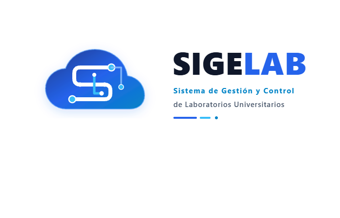

<p align="center">
  
</p>

<h1 align="center">SIGELAB</h1>

<p align="center">
  <strong>Sistema de Gestión y Control de Laboratorios Universitarios</strong><br>
  Proyecto Final · 017 Programación II · Universidad Mariano Gálvez de Guatemala
</p>

<p align="center">
  <a href="docs/ManualTecnico_SIGELAB.pdf"><strong>Manual Técnico</strong></a>
  &nbsp;·&nbsp;
  <a href="docs/ManualUsuario_SIGELAB.pdf"><strong>Manual de Usuario</strong></a>
</p>

## ¿Qué es?

SIGELAB es una aplicación de escritorio en Java que controla los equipos de los laboratorios
desde que se registran hasta que se dan de baja: quién tiene cada equipo, cuándo debe devolverlo,
en qué condición regresó y qué mantenimientos ha recibido. Toda la información se guarda en
SQL Server y cada operación importante queda registrada en una bitácora de auditoría.

## Funciones principales

| Módulo | Qué permite |
|---|---|
| Inicio de sesión | Entrar con usuario y contraseña, con validación facial como segundo factor. Incluye registro de cuentas y recuperación de contraseña por correo |
| Panel principal | Ver los equipos por estado y los préstamos activos y vencidos, y abrir los módulos que permite el rol |
| Equipos | Administrar el inventario y generar el código QR de cada equipo |
| Préstamos | Prestar uno o varios equipos, escribiendo el código o leyendo el QR desde una imagen o con la cámara |
| Devoluciones | Registrar devoluciones parciales o totales y la condición en que regresa cada equipo |
| Mantenimiento | Registrar órdenes preventivas y correctivas; al finalizar, el equipo vuelve a estar disponible o se da de baja |
| Reportes | Consultar equipos por estado; préstamos activos, finalizados, vencidos y entre fechas; e historial de cada equipo |
| Usuarios, laboratorios y tipos de equipo | Administrar los catálogos del sistema; los registros se desactivan, no se eliminan |
| Auditoría | Revisar quién hizo cada operación y cuándo |

| Rol | Acceso |
|---|---|
| ADMIN | Todos los módulos |
| ENCARGADO | Equipos, préstamos, devoluciones, mantenimiento y reportes |
| DOCENTE | Panel principal y reportes |

## Tecnologías

| Parte | Tecnología |
|---|---|
| Aplicación | Java 21, Swing, GUI Designer de IntelliJ IDEA, Maven |
| Base de datos | SQL Server 2022 en Docker, JDBC (`mssql-jdbc`) |
| Seguridad | jBCrypt 0.4 (contraseñas) y OpenCV 4.9 (reconocimiento facial) |
| Códigos QR | ZXing 3.5 y Webcam Capture 0.3 |
| Correo | Jakarta Mail 2.0 |

El código está organizado en capas: Vista → Controlador → Servicio → Repositorio → base de datos.

## Cómo ejecutarlo

### Requisitos

- Windows 10 u 11
- [Git](https://git-scm.com/)
- [Docker Desktop](https://www.docker.com/products/docker-desktop/)
- [IntelliJ IDEA](https://www.jetbrains.com/idea/)
- JDK 21 ([Temurin](https://adoptium.net/) u otro; IntelliJ también puede descargarlo)
- Cámara web (opcional): solo se usa para la validación facial y para leer QR con la cámara

### Primera vez

Con Docker Desktop abierto, ejecutar lo siguiente en PowerShell.

**1. Clonar el repositorio**

```powershell
git clone https://github.com/SaideVG/ProyectoLab_Prograll.git
cd ProyectoLab_Prograll
```

**2. Crear el contenedor de SQL Server**

```powershell
docker run -d --name sqlserver -p 1433:1433 -e "ACCEPT_EULA=Y" -e "MSSQL_SA_PASSWORD=ProyecLAB26" mcr.microsoft.com/mssql/server:2022-latest
```

**3. Crear la base de datos `SigelabDB` con sus datos de prueba**

```powershell
powershell -ExecutionPolicy Bypass -File .\database\cargar_en_docker.ps1
```

Windows bloquea los scripts por defecto; `-ExecutionPolicy Bypass` lo permite solo para este comando.

**4. Abrir el proyecto en IntelliJ IDEA**

1. En *File > Open*, elegir la carpeta `ProyectoLab_Prograll`.
2. Esperar a que Maven descargue las dependencias. La primera vez tarda, porque OpenCV pesa unos 100 MB.
3. En *File > Project Structure > Project*, seleccionar un JDK 21.

**5. Ejecutar**

Arriba a la derecha, elegir la configuración **SIGELAB** y presionar ▶.

### Las siguientes veces

1. Abrir Docker Desktop.
2. Encender el contenedor:

   ```powershell
   docker start sqlserver
   ```

3. Presionar ▶ en IntelliJ IDEA.

> **Importante:** la aplicación se ejecuta desde IntelliJ IDEA, no con `mvn`. Las pantallas usan formularios
> `.form` del GUI Designer y solo el compilador de IntelliJ los prepara; con `mvn compile` fallan al abrirse.

### Usuarios de prueba

| Usuario | Contraseña | Rol |
|---|---|---|
| `admin` | `Admin2026!` | ADMIN |
| `encargado` | `Encargado2026!` | ENCARGADO |
| `docente` | `Docente2026!` | DOCENTE |

También existe `inactivo` / `Inactivo2026!`, una cuenta desactivada para comprobar que el sistema no la deja entrar.

Si el usuario no tiene rostro registrado, el sistema ofrece registrarlo al entrar. Una vez registrado,
la validación facial se pide en cada inicio de sesión.

### Configuración opcional

El código no guarda datos propios de cada computadora: se leen de variables de entorno.

| Variable | Para qué sirve |
|---|---|
| `DB_PASSWORD` | Contraseña de SQL Server, si el contenedor usa otra distinta de `ProyecLAB26` |
| `DB_URL`, `DB_USER` | Conectarse a otro servidor o con otro usuario |
| `SIGELAB_SMTP_HOST`, `SIGELAB_SMTP_USER`, `SIGELAB_SMTP_PASSWORD` | Activar el envío de correos para recuperar la contraseña |

Se definen con `setx`, por ejemplo `setx DB_PASSWORD "mi_contraseña"`, y luego hay que cerrar y volver a abrir
IntelliJ IDEA. La lista completa está en la sección 6.2 del [Manual Técnico](docs/ManualTecnico_SIGELAB.pdf).

### Si algo falla

| Problema | Solución |
|---|---|
| El login abre, pero no deja entrar y no conecta con la base | Docker está apagado: abrir Docker Desktop y ejecutar `docker start sqlserver` |
| `docker run` indica que el nombre `sqlserver` ya está en uso | El contenedor ya existe: basta con `docker start sqlserver` |
| No aparece la configuración SIGELAB o el botón ▶ | Abrir el panel Maven, presionar *Reload All Maven Projects* y elegir SIGELAB en la lista de arriba a la derecha |
| Error `panelPrincipal` is null al abrir una pantalla | Compilar desde IntelliJ IDEA con *Build > Rebuild Project* |

## Estructura del repositorio

```
├── src/main/java/universidad/sigelab/
│   ├── view/          Pantallas Swing
│   ├── controller/    Puente entre las pantallas y los servicios
│   ├── service/       Reglas de negocio (RN-01 a RN-20), validaciones y auditoría
│   ├── repository/    Consultas SQL
│   ├── model/         Entidades
│   ├── enums/         Estados y catálogos fijos
│   ├── config/        Conexión a la base de datos
│   └── util/          Sesión, transacciones y utilidades
├── src/main/resources/    Logo y modelos de reconocimiento facial
├── database/              Scripts de la base de datos
├── docs/                  Manuales y guías
├── qr/                    Imágenes de los códigos QR generados
├── api/                   API para la app móvil (Spring Boot)
└── movil/                 App móvil (Flutter)
```

## App móvil

El repositorio incluye una app móvil en Flutter que complementa al escritorio: consulta los equipos, los préstamos
y los mantenimientos y lee los códigos QR, a través de una API en Spring Boot que usa la misma base de datos.
No hace falta para usar la aplicación de escritorio. Se explica en [movil/README.md](movil/README.md),
[api/README.md](api/README.md) y la [guía de la app móvil](docs/SIGELAB_Guia_App_Movil.pdf).

## Documentación

| Documento | Contenido | Archivos |
|---|---|---|
| **Manual Técnico** | Arquitectura, modelo de datos, reglas de negocio, despliegue y contingencia | [Ver PDF](docs/ManualTecnico_SIGELAB.pdf) · [Descargar Word](docs/ManualTecnico_SIGELAB.docx) |
| **Manual de Usuario** | Uso paso a paso de cada pantalla del sistema | [Ver PDF](docs/ManualUsuario_SIGELAB.pdf) · [Descargar Word](docs/ManualUsuario_SIGELAB.docx) |
| Cómo funciona el sistema | Estado del proyecto al 10 de octubre de 2026 | [Ver PDF](docs/SIGELAB_como_funciona.pdf) |
| Guía de la app móvil | Instalación de la app móvil, la API y su conexión | [Ver PDF](docs/SIGELAB_Guia_App_Movil.pdf) |
